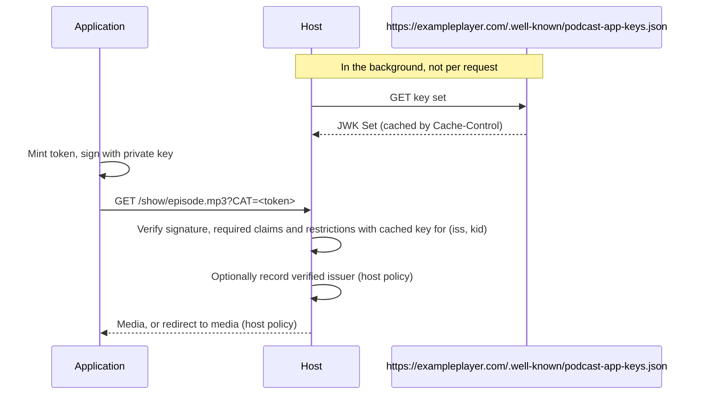
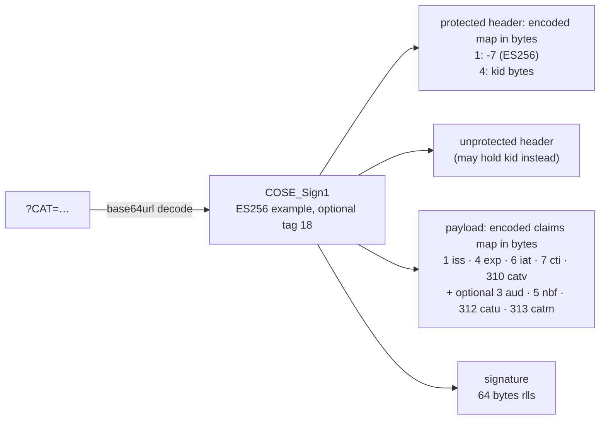

# Verified App Attribution

**Draft 0.1 — experimental.** This specification is intended to gather implementation experience before consideration by the Podcast Standards Project or another standards body. Expect it to change.

The key words MUST, MUST NOT, SHOULD, SHOULD NOT and MAY are to be interpreted as described in RFC 2119.

## Principles

- **A non-blocking trust signal for podcast applications.** The signal attributes a request to a verified issuer domain. What a host does with that is the host's policy; this specification defines the signal and how to verify it, not what follows.
- **The domain is the identity.** An application verifies as itself by publishing a key on its own domain. There is no registry, no approval, and nobody to ask.
- **Verified means attributable, not necessarily countable.** A valid token attributes the request to the application's verified issuer domain; it does not show that the request represents a listen.

## Why

Hosts identify applications by user-agent string. User agents are unverifiable, often generic (`okhttp`, `Dalvik`, `CFNetwork`), and trivially spoofed, so a real application's requests are under-counted or mixed with junk, and the application has no way to object. A signed request gives a host a verified issuer to attribute to, and gives the application a cryptographically verifiable attribution signal that nobody else can forge without its signing key.

## Overview

Two parties: the **application** (a podcast player) and the **host** (whoever serves the episode URL). The application is the **issuer** of the token; its identity is its web origin, such as `https://exampleplayer.com`.

1. The application starts with the episode's enclosure URL — the media URL in the podcast feed — as today.
2. Before sending the media request, it appends one query parameter, `CAT`, carrying a signed token:

   ```
   https://host.example/show/episode.mp3?CAT=<token>
   ```

3. The host verifies the token against the key the application publishes on its origin and handles the request as it sees fit, now able to attribute it to that issuer.

The application does nothing further. Redirect handling after verification is outside the scope of this specification.



This is an attribution profile of the Common Access Token (CTA-5007-B). It uses CAT's encoding and the claims named below; implementing it does not require a general-purpose CAT library on either side.

## The token

### Encoding

The token is binary, in CBOR (RFC 8949, a compact binary JSON-like format). It is a COSE_Sign1 structure (RFC 9052) with four fields: the protected header (a CBOR map, encoded into a byte string), the unprotected header (a plain map), the payload (the claims map, encoded into a byte string), and one signature. This combination is a CBOR Web Token (RFC 8392). Encoding MUST follow the deterministic CBOR rules in CTA-5007-B §4.5 (no indefinite-length containers, no unnecessary tags), except that map-key ordering is unrestricted.



This example places `kid` in the protected header; it may instead appear in the unprotected header.

The `CAT` parameter value is the base64url encoding of the complete serialized token, including any enclosing CBOR tags. Senders SHOULD wrap the COSE_Sign1 in tag 18 and SHOULD omit `=` padding. Receivers MUST accept the object untagged, with tag 18, or with CWT tag 61 around tag 18, and MUST accept the string with or without padding.

### Claims

Claims use the integer labels registered for CWT and CAT (the IANA CWT Claims registry).

Required:

| Claim | Label | Type | Value |
|---|---|---|---|
| `iss` | 1 | text | The application's origin: `https://`, a lowercase ASCII hostname, and the port only if it is not 443. No path, query, fragment, credentials or trailing slash. Example: `https://exampleplayer.com`. |
| `exp` | 4 | integer | Expiry, Unix seconds. MUST be after `iat` and no more than 24 hours after it. A few minutes is RECOMMENDED. |
| `iat` | 6 | integer | Issued at, Unix seconds. |
| `cti` | 7 | bytes | Token id: at least 8 cryptographically random bytes, generated independently for every token. |
| `catv` | 310 | integer | `1`. |

Optional. When present a host MUST enforce them:

| Claim | Label | Type | Value |
|---|---|---|---|
| `catu` | 312 | map | Restricts the token to a URL. A map from URL component (0 scheme, 1 host, 2 port, 3 path, 4 query) to a match rule; `{0: "value"}` means exact match. Issuers build it from the URL after removing the `CAT` parameter and normalizing as CTA-5007-B §4.6.10 describes. Hosts compare against the normalized request URL and, if that fails, once more with the path and query exactly as received (with only `CAT` removed), so an issuer that binds them verbatim still matches. Scheme, host and port are always compared normalized. A per-request token SHOULD exact-match scheme, host, path and query; port is optional. |
| `catm` | 313 | array of text | HTTP methods the token is good for, normally `["GET", "HEAD"]`. Case-sensitive. |
| `aud` | 3 | text | The intended recipient. Normally the origin of the public request URL: scheme, lowercase ASCII hostname, the port only if non-default, no trailing slash (unlike `iss`, the scheme follows the media URL and may be `http` or `https`). A host MUST accept its own request origin, compared exactly before any redirect or internal rewrite, and MAY accept other values configured per issuer, such as a URN the issuer uses for all recipients. A host behind a proxy takes its origin from its own trusted proxy configuration, not from arbitrary client headers. |
| `nbf` | 5 | integer | Not before, Unix seconds. |

Example `catu` for a per-request token on `https://host.example/show/episode.mp3?id=42`:

```
312: {
  0: {0: "https"},
  1: {0: "host.example"},
  2: {0: ""},
  3: {0: "/show/episode.mp3"},
  4: {0: "id=42"}
}
```

Normalization removes the default HTTPS port, so the normalized port component is the empty string. A `catu` that omits component 2 matches any port, which is the usual choice.

The token MUST NOT contain listener or device identifiers. `sub` is not used. Note that a session token reused across requests lets the host correlate those requests with one another until it expires.

### Signature

- The protected header MUST contain `alg` (label 1): `-7` for ES256 (ECDSA with P-256 and SHA-256) or `-8` for EdDSA (Ed25519). Hosts MUST support ES256 and MAY support EdDSA. Applications MUST use ES256 unless they know the host accepts EdDSA.
- The `kid` header (label 4) is a byte string: the UTF-8 bytes of the `kid` of the JWK that signed the token. It MUST appear in exactly one of the protected or unprotected headers; hosts MUST accept either location.
- The signature is computed as RFC 9052 §4.4 specifies, with empty external additional data. An ES256 signature is `r` then `s`, each as 32 unsigned big-endian bytes (left-padded with zeros), concatenated: 64 bytes, not DER.

### Two patterns

Both are valid; a host MUST accept either. Per-request tokens are RECOMMENDED.

- **Per request** (recommended). A fresh token for each media request, a few minutes long, bound to the URL with `catu`. It is useless anywhere else, and no identifier repeats across requests.
- **Per session.** One token per application launch or per hour, without `catu`, attached to every request until it expires. Simpler for the application, at the cost of the same `cti` appearing on every request until expiry, which lets a host correlate them for that long.

Verification happens when the host receives a request. Expiry during a transfer does not affect that transfer; a later request, including a resumed range request, needs a token that is valid at that moment.

### Protecting the key

Implementations SHOULD protect private signing keys from distribution or extraction. Minting tokens on infrastructure controlled by the application publisher is one recommended approach. A minting service SHOULD be able to issue session tokens without being told the episode URL or anything about the listener, and obtaining a token SHOULD NOT delay the media request.

## Publishing keys

Unless a host has configured another location for the issuer (below), the application MUST serve a JWK Set (RFC 7517: a JSON object with a `keys` array of public-key objects) over HTTPS at a fixed path under its `iss` origin:

```
<iss>/.well-known/podcast-app-keys.json
```

- Public keys only. Each key MUST carry `kid` (unique within the set), `kty`, `use: "sig"` and the curve parameters: `kty: "EC"`, `crv: "P-256"`, `x`, `y` for ES256; `kty: "OKP"`, `crv: "Ed25519"`, `x` for EdDSA. If a key carries `alg` it MUST match the token's algorithm (`"ES256"` or `"EdDSA"`); if it carries `key_ops` the array MUST include `"verify"`. A key that does not meet these requirements, or whose type does not fit the token's algorithm, is treated as absent.
- The response SHOULD include `Cache-Control: max-age=<seconds>`. Hosts MUST use that lifetime, or one hour when none is given, and SHOULD refresh before it expires. If the cached set expires before a successful refresh, verification returns `key_unavailable` until a fresh set is available.
- To rotate: publish the new key beside the old one, wait at least the lifetime advertised for the previous key set (or one hour), start signing with the new key, and remove the old key only after the last token signed with it has expired.

Hosts MUST NOT fetch keys while a listener's request waits. If no cached key matches the token's (`iss`, `kid`), the request is treated as unverified with reason `key_unavailable` and a background refresh is scheduled, rate-limited per issuer.

CTA-5007 leaves key exchange out of scope. A host MAY configure the key-set URL for a given issuer by hand, for applications that publish keys elsewhere. That replaces the discovery URL only; the freshness and background-refresh rules still apply, and a host SHOULD preload a configured issuer's keys before it expects requests, so the first ones are not `key_unavailable`. The well-known path is the default that needs no coordination.

```json
{
  "keys": [
    {
      "kty": "EC", "crv": "P-256", "use": "sig", "kid": "2026-11",
      "x": "<base64url>", "y": "<base64url>"
    }
  ]
}
```

`x` and `y` are the P-256 public point's coordinates, each exactly 32 unsigned big-endian bytes (left-padded with zeros), base64url-encoded without padding, as RFC 7518 §6.2 specifies.

## Attaching the token

- Append exactly one `CAT` parameter, using `?` or `&` as the URL requires, leaving the existing URL bytes and parameter order untouched. When looking for an existing or duplicate `CAT`, split the query on `&`, take the name as everything before the first `=`, percent-decode it once, and compare it case-sensitively with `CAT`.
- If the URL already contains a `CAT` parameter, leave it alone.
- Hosts MUST treat a request with more than one `CAT` parameter as unverified (`malformed`).

Appending a parameter can break URLs that are themselves signed by a third party. Applications SHOULD be able to turn attribution off for an origin that rejects the modified URL.

## Verification

A host verifies a token with the steps below, in this order. The first check that fails decides the reason, so two hosts report the same reason for the same token.

1. **Decode.** Decode the base64url value as one complete COSE_Sign1 with an embedded claims-map payload. Reject trailing data, duplicate map keys, an unsupported `alg`, a missing `kid`, a label present in both headers, and any `crit` header (label 2) entry the verifier does not understand. Hosts SHOULD also reject tokens that are not deterministically encoded. Ignore unknown claims. Failure: `malformed`.
2. **Claims.** Check that every required claim is present with the type and checkable constraints above (`iss` syntax, `cti` at least 8 bytes, `catv` equal to `1`), that optional claims have the types above, and that `iat < exp ≤ iat + 86400`. Failure: `malformed`. Randomness of `cti` and the absence of listener identifiers cannot be checked from the bytes; they are issuer obligations.
3. **Time.** With `now` captured when the request arrived, and no clock-skew leeway (CTA-5007-B requires this): `now < exp`, else `expired`; `nbf ≤ now` when present, else `not_yet_valid`.
4. **Key.** Select the key for (`iss`, `kid`) from the issuer's cached set, published at the well-known path or at the location configured for that issuer. Keys are only ever looked up under the token's own `iss`. No usable key: `key_unavailable`.
5. **Signature.** Failure: `bad_signature`.
6. **Restrictions**, when present, against the request as received: `catu` (`url_mismatch`), then `catm` (`method_mismatch`), then `aud` (`audience_mismatch`). A `catu` using a match type the host does not support fails as `url_mismatch`.

The outcome is a verified issuer, or *unverified* with one of the reasons above.

What the host does next is its own policy. A host MAY serve an unverified request exactly as it does today, MAY record the verified issuer in its statistics, and MAY apply any other policy it chooses. This specification does not require any particular treatment of signed, unsigned or failed requests.

## Self-check

A host implementing this specification SHOULD serve a self-check endpoint:

```
GET <host>/.well-known/podcast-app-attribution?CAT=<token>
```

A host implementing the self-check endpoint MUST respond `200` with `Content-Type: application/json` and `Cache-Control: no-store`. On success:

```json
{ "verified": true, "iss": "https://exampleplayer.com", "kid": "2026-11", "exp": 1800000000,
  "catu": true, "catm": null, "aud": null }
```

where each restriction field is `true` when present and matched, `null` when absent. On failure:

```json
{ "verified": false, "reason": "bad_signature" }
```

using a reason from [Verification](#verification). The check evaluates `catu`, `catm` and `aud` against the self-check request itself. An otherwise valid token bound to an episode URL therefore reports `url_mismatch`, which says nothing about its signature; an earlier failure (`expired`, `bad_signature`) is reported instead when it occurs first. To test a per-request token end to end, the issuer needs to be able to mint one bound to the self-check URL.

## Security considerations

- **Replay.** A token can be replayed until it expires wherever its restrictions match: `catu` limits the URLs, `catm` the methods, `aud` the recipient. A session token without `aud` or `catu` can be replayed to any host. `cti` identifies a token but does not prevent replay. Short expiries limit the window. This is acceptable for an attribution signal; it would not be for access control.
- **Key fetching.** The `iss` of an unverified token is a URL the host is about to fetch. Automatic discovery MUST verify TLS certificates, MUST check the actual connection destination against loopback, private, link-local and other non-public ranges on every connection, MUST refuse redirects outside the issuer's origin, and MUST limit response size and fetch rate both globally and per issuer. Any other key location requires explicit per-issuer configuration.
- **Key compromise.** An extracted signing key lets anyone sign as the application for as long as a host still trusts that key; removing it from the published set takes effect at each host only once that host's cached set refreshes. Rotation is the remedy, which is why keys are fetched from the origin rather than pinned.

## Open questions

- Whether `aud` should become required.
- Whether hosts should strip `CAT` before redirecting to media on a third-party CDN, so the token never reaches another party's logs.
