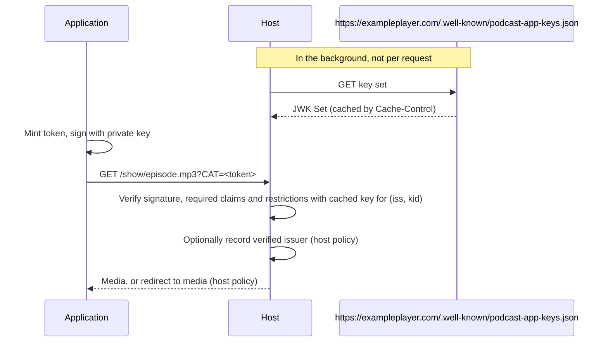
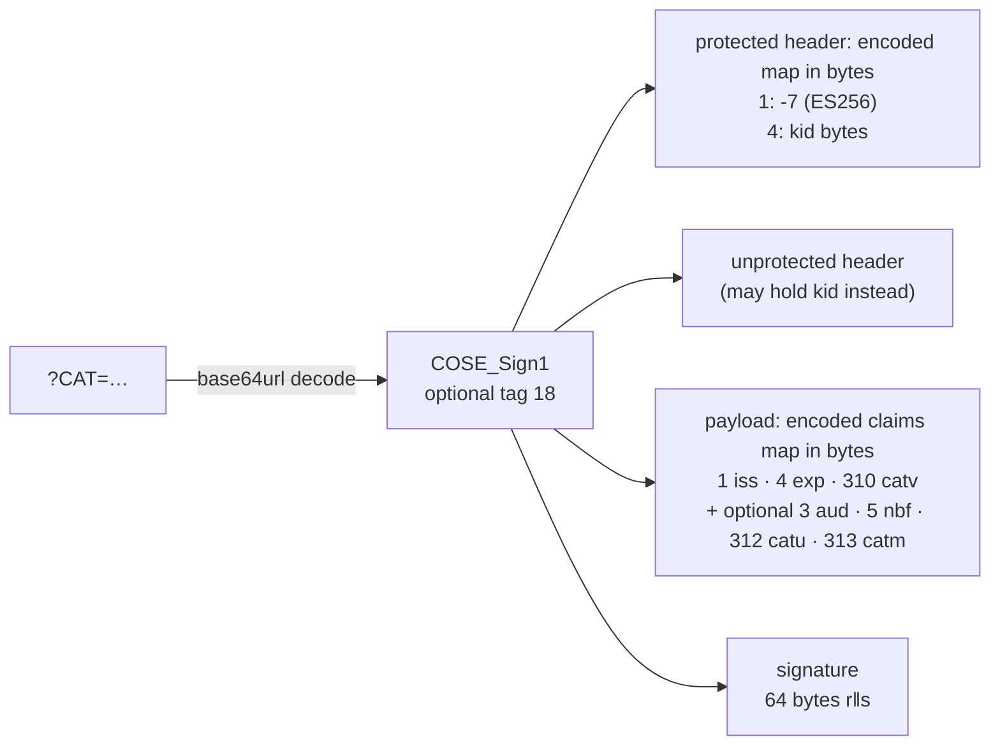

# Verified App Attribution

**Draft 0.1 — experimental.** This specification is intended to gather implementation experience before consideration by the Podcast Standards Project or another standards body. Expect it to change.

The key words MUST, MUST NOT, SHOULD, SHOULD NOT and MAY are to be interpreted as described in RFC 2119.

## Principles

- **A non-blocking trust signal for podcast applications.** The signal attributes a request to a verified issuer domain. What a host does with that is the host's policy; this specification defines the signal and how to verify it, not what follows.
- **The domain is the identity.** An application verifies as itself by publishing a key on its own domain. There is no registry, no approval, and nobody to ask.
- **Verified means attributable, not necessarily countable.** A valid token attributes the request to the application's verified issuer domain; it does not show that the request represents a listen.

## Why

Hosts identify applications by user-agent string. User agents are unverifiable, often generic (`okhttp`, `Dalvik`, `CFNetwork`), and trivially spoofed, so a real application's requests are under-counted or mixed with junk, and the application has no way to object. A signed request gives a host a verified issuer to attribute to, and gives the application a cryptographically verifiable attribution signal that nobody else can forge without its signing key.

### What a verified request means

A verified request carried a token that was valid when the request arrived and was signed with a key published for the issuer's domain. Nothing more is established.

- It does not establish that the issuer's application sent the request. A token is a bearer credential: whoever obtains one can present it until it expires, wherever its restrictions match. Short lifetimes and URL binding narrow where and for how long a copied token works. They do not remove the possibility.
- It does not establish that a person listened.
- It is only as strong as the issuer's control of its signing key ([Protecting the key](#protecting-the-key)).

How much weight the signal carries is the host's decision.

## Overview

Two parties: the **application** (a podcast player) and the **host** (whoever serves the episode URL). The application is the **issuer** of the token; its identity is its web origin, such as `https://exampleplayer.com`.

1. The application starts with the episode's enclosure URL — the media URL in the podcast feed — as today.
2. Before sending the media request, it appends one query parameter, `CAT`, carrying a signed token:

   ```
   https://host.example/show/episode.mp3?CAT=<token>
   ```

3. The host verifies the token against the key the application publishes on its origin and handles the request as it sees fit, now able to attribute it to that issuer.

The application does nothing further. Redirect handling after verification is outside the scope of this specification.



This is an attribution profile of the Common Access Token (CTA-5007-B). It uses CAT's encoding and the claims named below; implementing it does not require a general-purpose CAT library on either side.

## The token

### Encoding

The token is binary, in CBOR (RFC 8949, a compact binary JSON-like format). It is a COSE_Sign1 structure (RFC 9052) with four fields: the protected header (a CBOR map, encoded into a byte string), the unprotected header (a plain map), the payload (the claims map, encoded into a byte string), and one signature. This combination is a CBOR Web Token (RFC 8392). Encoding MUST follow the deterministic CBOR rules in CTA-5007-B §4.5 (no indefinite-length containers, no unnecessary tags), except that map-key ordering is unrestricted.



This example places `kid` in the protected header; it may instead appear in the unprotected header.

The `CAT` parameter value is the base64url encoding of the complete serialized token, including any enclosing CBOR tags. Senders SHOULD wrap the COSE_Sign1 in tag 18 and SHOULD omit `=` padding. Receivers MUST accept the object untagged, with tag 18, or with CWT tag 61 around tag 18, and MUST accept the string with or without padding.

### Claims

Claims use the integer labels registered for CWT and CAT (the IANA CWT Claims registry).

Required:

| Claim | Label | Type | Value |
|---|---|---|---|
| `iss` | 1 | text | The application's origin: `https://`, a lowercase ASCII hostname, and the port only if it is not 443. No path, query, fragment, credentials or trailing slash. Example: `https://exampleplayer.com`. |
| `exp` | 4 | integer | Expiry, Unix seconds. A few minutes after minting is RECOMMENDED. A token verifies only during the 24 hours before its `exp` (see [Time](#time)). |
| `catv` | 310 | integer | `1`. |

Optional. When present a host MUST enforce them:

| Claim | Label | Type | Value |
|---|---|---|---|
| `catu` | 312 | map | Restricts the token to a URL. A map from URL component (0 scheme, 1 host, 2 port, 3 path, 4 query) to a match rule; `{0: "value"}` means exact match. Issuers build it from the URL after removing the `CAT` parameter and normalizing as CTA-5007-B §4.6.10 describes. Hosts compare against the normalized request URL and, if that fails, once more with the path and query exactly as received (with only `CAT` removed), so an issuer that binds them verbatim still matches. Scheme, host and port are always compared normalized. A per-request token SHOULD exact-match scheme, host, path and query; port is optional. Hosts MUST support exact match on these five components. The other match types and components CTA-5007-B defines are optional for hosts, and a `catu` that uses one a host does not support does not match on that host, so an issuer that wants every host to verify its tokens uses exact matches only. |
| `catm` | 313 | array of text | HTTP methods the token is good for, normally `["GET", "HEAD"]`. Case-sensitive. |
| `aud` | 3 | text | The intended recipient. Normally the origin of the public request URL: scheme, lowercase ASCII hostname, the port only if non-default, no trailing slash (unlike `iss`, the scheme follows the media URL and may be `http` or `https`). A host MUST accept its own request origin, compared exactly before any redirect or internal rewrite, and MAY accept other values configured per issuer, such as a URN the issuer uses for all recipients. A host behind a proxy takes its origin from its own trusted proxy configuration, not from arbitrary client headers. |
| `nbf` | 5 | integer | Not before, Unix seconds. |

Optional, with no meaning in this specification. Tokens from other CAT issuers often carry them, so they are allowed; a host checks only their type:

| Claim | Label | Type | Value |
|---|---|---|---|
| `iat` | 6 | integer | Issued at, Unix seconds. |
| `cti` | 7 | bytes | Token id. |

Example `catu` for a per-request token on `https://host.example/show/episode.mp3?id=42`:

```
312: {
  0: {0: "https"},
  1: {0: "host.example"},
  2: {0: ""},
  3: {0: "/show/episode.mp3"},
  4: {0: "id=42"}
}
```

Normalization removes the default HTTPS port, so the normalized port component is the empty string. A `catu` that omits component 2 matches any port, which is the usual choice.

The token MUST NOT contain listener or device identifiers. `sub` is not used. Note that a session token reused across requests lets the host correlate those requests with one another until it expires.

### Signature

- The protected header MUST contain `alg` (label 1) with the value `-7`: ES256, which is ECDSA with P-256 and SHA-256. It is the only algorithm in this draft.
- The `kid` header (label 4) is a byte string: the UTF-8 bytes of the `kid` of the JWK that signed the token. It MUST appear in exactly one of the protected or unprotected headers; hosts MUST accept either location.
- The signature is computed as RFC 9052 §4.4 specifies, with empty external additional data. An ES256 signature is `r` then `s`, each as 32 unsigned big-endian bytes (left-padded with zeros), concatenated: 64 bytes, not DER.

### Two patterns

Both are valid, and a host does not need to tell them apart: it enforces whatever restrictions a token carries. Per-request tokens are RECOMMENDED.

- **Per request** (recommended). A fresh token for each media request, a few minutes long, bound to the URL with `catu`. It is useless anywhere else, and every request carries a different token.
- **Per session.** One token per application launch or per hour, without `catu`, attached to every request until it expires. Simpler for the application. The costs are that the same token appears on every request until it expires, which lets a host correlate them for that long, and that a copy of it works at any host.

### Time

A host takes `now` when the request arrives and allows no clock-skew leeway, as CTA-5007-B requires. A token verifies only when all of these hold:

- `now < exp`.
- `exp ≤ now + 86400`.
- `nbf ≤ now`, when `nbf` is present.

The second rule means any one token can verify for at most 24 hours: from 24 hours before its `exp` until its `exp`. It bounds how long a copied token keeps working, and it makes a long-lived token pointless. It is not a limit on when the token was minted, which a host cannot observe. A token minted with a later `exp` simply does not verify until its last 24 hours.

Verification happens when the host receives a request. Expiry during a transfer does not affect that transfer; a later request, including a resumed range request, needs a token that is valid at that moment.

### Protecting the key

Implementations SHOULD protect private signing keys from distribution or extraction. Minting tokens on infrastructure controlled by the application publisher is one recommended approach. A minting service SHOULD be able to issue session tokens without being told the episode URL or anything about the listener, and obtaining a token SHOULD NOT delay the media request.

No arrangement is required. The rest of this section is not normative; it describes what each choice is worth.

- **A key inside the application.** No server is needed, and each request can have its own URL-bound token. But a key shipped in an application can be extracted, and from then on anyone can sign as the application. Rotation is the only remedy, and it is slow: a new key reaches listeners only as they update, and removing the old key stops every older version from verifying. The token's times also come from the device's clock, which hosts check without leeway, so a device with a wrong clock mints tokens that fail. This asks more of an imitator than copying a user-agent string, and it is the weakest arrangement.
- **A minting service.** The key stays on the publisher's infrastructure and the application fetches tokens from it. The key cannot be extracted and the clock is the server's. The question moves to who may ask for a token. An open endpoint hands one to any caller, though the publisher can at least rate-limit it, watch it and shut off abuse, none of which is possible for a user-agent string. Platform attestation or an account check narrows it further. This need not be much infrastructure: a single serverless function is enough.
- **What the service mints.** A token per request tells the service every URL the listener plays and puts a round trip before each one. A session token fetched ahead of time avoids both, which is what the requirements above ask for, at the price of being replayable to any host until it expires. A token whose `catu` names only the host sits between the two: the service learns the hostname and nothing else, and the token does not match at any other host.

The mobile [examples](examples/) sign inside the application because that is the shortest way to show how a token is built. They are demonstrations of the format, not a recommended production design.

## Publishing keys

Unless a host has configured another location for the issuer (below), the application MUST serve a JWK Set (RFC 7517: a JSON object with a `keys` array of public-key objects) over HTTPS at a fixed path under its `iss` origin:

```
<iss>/.well-known/podcast-app-keys.json
```

- Public keys only. Each signing key MUST carry `kid` (unique within the set), `use: "sig"`, `kty: "EC"`, `crv: "P-256"`, `x` and `y`. If it carries `alg` that MUST be `"ES256"`; if it carries `key_ops` the array MUST include `"verify"`. Any key in the set that does not meet these requirements is treated as absent.
- The response SHOULD include `Cache-Control: max-age=<seconds>`. Hosts MUST use that lifetime, or one hour when none is given, and SHOULD refresh before it expires. If the cached set expires before a successful refresh, verification returns `key_unavailable` until a fresh set is available.
- To rotate: publish the new key beside the old one, wait at least the lifetime advertised for the previous key set (or one hour), start signing with the new key, and remove the old key only after the last token signed with it has expired.

Hosts MUST NOT fetch keys while a listener's request waits. If no cached key matches the token's (`iss`, `kid`), the request is treated as unverified with reason `key_unavailable` and a background refresh is scheduled, rate-limited per issuer.

CTA-5007 leaves key exchange out of scope. A host MAY configure the key-set URL for a given issuer by hand, for applications that publish keys elsewhere. That replaces the discovery URL only; the freshness and background-refresh rules still apply, and a host SHOULD preload a configured issuer's keys before it expects requests, so the first ones are not `key_unavailable`. The well-known path is the default that needs no coordination.

```json
{
  "keys": [
    {
      "kty": "EC", "crv": "P-256", "use": "sig", "kid": "2026-11",
      "x": "<base64url>", "y": "<base64url>"
    }
  ]
}
```

`x` and `y` are the P-256 public point's coordinates, each exactly 32 unsigned big-endian bytes (left-padded with zeros), base64url-encoded without padding, as RFC 7518 §6.2 specifies.

## Attaching the token

- Append exactly one `CAT` parameter, using `?` or `&` as the URL requires, leaving the existing URL bytes and parameter order untouched. When looking for an existing or duplicate `CAT`, split the query on `&`, take the name as everything before the first `=`, percent-decode it once, and compare it case-sensitively with `CAT`.
- If the URL already contains a `CAT` parameter, leave it alone.
- Hosts MUST treat a request with more than one `CAT` parameter as unverified (`malformed`).

Appending a parameter can break URLs that are themselves signed by a third party. Applications SHOULD be able to turn attribution off for an origin that rejects the modified URL.

## Verification

A request is **verified** when it carries one token that passes every check below. Otherwise it is **unverified**, which includes a request with no token.

Hosts need to agree on that outcome and on the issuer. They do not need to agree on why a request failed. A host MAY make the checks in any order, and the reasons named here are diagnostic: a token with more than one fault can fairly be reported under any of them.

1. **Decode.** The base64url value decodes as one complete COSE_Sign1 with an embedded claims-map payload. Reject trailing data, duplicate map keys, an `alg` other than ES256, a missing `kid`, a label present in both headers, and any `crit` header (label 2) entry the verifier does not understand. Hosts SHOULD also reject tokens that are not deterministically encoded. Ignore unknown claims. Reason: `malformed`.
2. **Claims.** `iss`, `exp` and `catv` are present with the types and constraints above (`iss` syntax, `catv` equal to `1`), and any optional claim that is present has the type above. Reason: `malformed`. The absence of listener identifiers cannot be checked from the bytes; it is an issuer obligation.
3. **Time.** The rules in [Time](#time) hold. Reason: `expired` when `now` has reached `exp`, otherwise `not_yet_valid`.
4. **Key.** The issuer's cached set, published at the well-known path or at the location configured for that issuer, has a usable key for (`iss`, `kid`). Keys are only ever looked up under the token's own `iss`. Reason: `key_unavailable`.
5. **Signature.** The signature verifies with that key. Reason: `bad_signature`.
6. **Restrictions.** Each one present matches the request as received: `catu` (`url_mismatch`), `catm` (`method_mismatch`), `aud` (`audience_mismatch`).

The outcome is a verified issuer, which is the token's `iss`, or *unverified*.

What the host does next is its own policy. A host MAY serve an unverified request exactly as it does today, MAY record the verified issuer in its statistics, and MAY apply any other policy it chooses. This specification does not require any particular treatment of signed, unsigned or failed requests.

## Self-check

A host implementing this specification SHOULD serve a self-check endpoint:

```
GET <host>/.well-known/podcast-app-attribution?CAT=<token>
```

A host implementing the self-check endpoint MUST respond `200` with `Content-Type: application/json` and `Cache-Control: no-store`. For a verified token:

```json
{ "verified": true, "iss": "https://exampleplayer.com" }
```

Otherwise:

```json
{ "verified": false, "reason": "bad_signature" }
```

`reason` is optional. When given, it SHOULD be one of the reasons from [Verification](#verification).

The check evaluates `catu`, `catm` and `aud` against the self-check request itself. An otherwise valid token bound to an episode URL is therefore unverified here (`url_mismatch`), which says nothing about its signature. To test a per-request token end to end, the issuer mints one bound to the self-check URL.

## Deployment considerations

This section is not normative. It records how the query parameter meets real podcast delivery, including the parts Draft 0.1 does not solve.

- **Redirects.** The token goes to the server named in the enclosure URL, which is the first hop. Many enclosure URLs redirect, through a measurement prefix or from the host to its CDN. What reaches a later hop depends on whether each redirecting server copies the query string. A session token that is forwarded can still verify there. A URL-bound token cannot, because it is bound to the first URL, and reports `url_mismatch`. In practice the server at the enclosure URL is the one that can verify, and a host that sits behind a third party's prefix may receive nothing usable.
- **Caching.** Every token makes a different URL. A CDN that includes the whole query string in its cache key, which is the default on several, treats each tokened request as a new object and fetches it from the origin again. A host that verifies tokens therefore needs `CAT` left out of the cache key while still seeing it. Two ways to do that are to verify at the edge before the cache lookup, or to verify afterwards from request logs, which can record the full URL even when the response came from cache. A host that does not verify tokens, and whose CDN keys on the query string, would see more cache misses from applications that send them. How much that matters in practice is something this draft is meant to find out (see [Open questions](#open-questions)).
- **URLs that are already signed.** Some enclosure URLs carry a signature of their own that covers the query string, and reject any added parameter. This is why [Attaching the token](#attaching-the-token) asks applications to be able to turn attribution off per origin.
- **Logs and forwarded URLs.** A token in a URL is written wherever URLs are written: access logs at every hop, CDN logs, and anything downstream that stores request URLs. Anyone who can read it can replay it until it expires, within its restrictions. Short lifetimes are the main defence. A host can also drop the `CAT` value from logs it keeps, and leave it out of the redirects it issues.
- **Range requests and long sessions.** A player fetches one episode with many requests, and each is verified by itself. A player that fixes the URL when playback starts keeps sending the same token, so requests made after it expires report `expired` while earlier ones verified. One play can therefore be partly verified, and how a host attributes it is the host's policy. An application that can sign each request should. One that cannot may prefer a lifetime that covers a typical session, within the 24-hour limit.
- **Where verification happens.** Nothing requires it to happen in the request path. A host can verify at its edge, at its origin, or afterwards from request logs, as long as it uses the time the request arrived.

## Security considerations

- **Replay.** A token can be replayed until it expires wherever its restrictions match: `catu` limits the URLs, `catm` the methods, `aud` the recipient. A session token without `aud` or `catu` can be replayed to any host. Short expiries limit the window, and no token verifies for longer than 24 hours. This is acceptable for an attribution signal; it would not be for access control.
- **Key fetching.** The `iss` of an unverified token is a URL the host is about to fetch. Automatic discovery MUST verify TLS certificates, MUST check the actual connection destination against loopback, private, link-local and other non-public ranges on every connection, MUST refuse redirects outside the issuer's origin, and MUST limit response size and fetch rate both globally and per issuer. Any other key location requires explicit per-issuer configuration.
- **Key compromise.** An extracted signing key lets anyone sign as the application for as long as a host still trusts that key; removing it from the published set takes effect at each host only once that host's cached set refreshes. Rotation is the remedy, which is why keys are fetched from the origin rather than pinned.

## Open questions

- Whether `aud` should become required.
- Whether hosts should strip `CAT` before redirecting to media on a third-party CDN, so the token never reaches another party's logs.
- Whether applications need a way to learn which hosts verify tokens, and what it would be. It should not require an application to keep a list of hosts or to make an extra request before fetching media.
- Whether an application should sign each hop of a redirect chain, where its HTTP client allows that.
